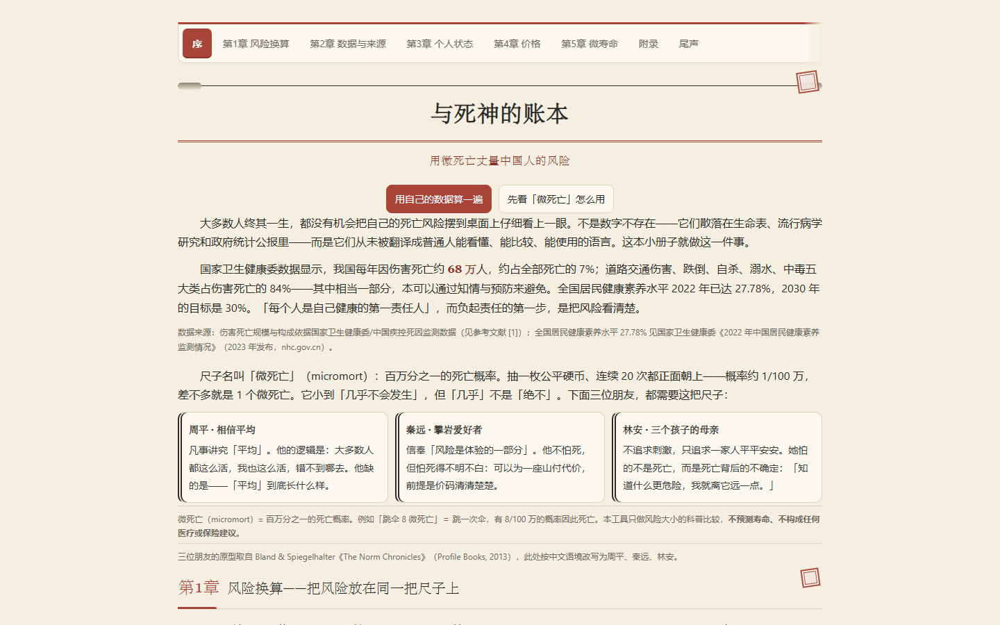

# 与死神的账本 · 用微死亡丈量中国人的风险

> 一本交互式科普出版物：把「死亡风险」翻译成普通人能看懂、能比较、能使用的语言。



<sub>截图为 2026-11-13 构建（v1.0.1），1440×900 首屏；由本机无头 Edge 生成，非手工截图。</sub>

> ⚠️ **免责声明**：本工具只做「风险大小」的科普比较，不预测寿命，不构成任何医疗或保险建议，结果不能用于个体医疗决策或保险定价。

---

## 它是什么

我们每天都在和死亡风险打交道——吸烟、喝酒、超重、熬夜——但很少有人能说清这些选择到底让风险变了多少。「与死神的账本」用两把尺子回答这个问题：

- **微死亡（micromort）**：百万分之一的死亡概率。跳一次伞约 8 微死亡；以 40 岁男性为例，每天吸 20 支烟约相当于每年多出 1,100 微死亡。
- **微寿命（microlife）**：半小时的预期寿命。每天吸烟 20 支约损失 5 小时/天，肥胖约 1.5 小时/天。

输入你的年龄、性别与生活习惯，页面就能估算你的个人死亡风险，并给出「和你数据相同的一群人」的平均曲线（确定性生命表 + 1,000 次系数抽样的带）作参照。

## 功能亮点

- **七章叙事**：序 → 风险换算 → 数据与来源 → 个人状态 → 价格 → 微寿命 → 尾声，竖划长页 + 顶部章节导航
- **账本美学**：米黄纸、墨、印泥红三色纪律；卷轴题额、无字印章；数据语义色（信度四色、系数不确定带蓝、风险红绿）独立于装饰
- **出版级著录**：正文 `[n]` 短标注 + 文末 34 条参考文献（GB/T 7714-2015），每条可点击跳转；事件条目可展开九项著录
- **证据分层**：方法长文默认折叠（「点开看全文」），正文只留要点——科学内容一字未删，阅读线轻、证据线全
- **单文件、零依赖**：一个 HTML 文件走天下，无外部字体/图片/框架，不联网、不上传
- **数据带走**：尾部可把全部本机数据导出为 JSON（只含 `rb_*` 键），换设备或清缓存后能导入还原；曲线下可挑一个已存档案做并排对照
- **无障碍基线**：全部控件有程序化名称（`label for` / `aria-label`）、`:focus-visible` 焦点环、跳转正文链接、`<main>` 地标、移动端 44px 触控、`prefers-reduced-motion`；`lint.js` 守住这些不退化
- **排版基线**：六档字号（12 元信息 / 14 正文 / 16 导语与卡片标题 / 20 章标题 / 24 章号与数字卡 / 32 封面）、三档行高、行宽随容器（960 容器、卡内不做窄排）；表格数字切等宽表格字体并开 `lining-nums`，打印按 15/12pt 同尺换算

## 快速开始

直接双击打开 `index.html` 即可。无需服务器、无需安装、无需联网。

```bash
# 复跑全部测试（需要 Node.js；只运行页面不需要）
npm test          # verify.js 25 条 + _test_funfact.js 6 条 + _test_init.js 5 条 + _test_render.js 30 条
npm run check     # 上面四套 + lint，一条命令全绿
node verify.js    # 25/25
node lint.js      # 语法 + 控件可达名 + 锚点自洽（零依赖静态体检）
node _test_funfact.js  # 6/6
node _test_render.js   # 30/30
```

## 数据与科学

- 基础死亡风险来自 **WHO GHO 中国一般人口生命表 2019–2023 五年平均**（5 岁组 lx → 单岁 qx；85 岁以上按 Gompertz 拟合外推）。
  - 不使用保险业经验生命表（CL4）：被保险人有承保筛选，40 岁男性死亡率仅为一般人口的一半，会让「普通人」的存活率系统性偏高。
  - 中国没有 2025 年的一般人口生命表：普查年才发完整表，其余年份只发人均预期寿命；WHO 2023 是标准估计的最新一年。
- 9 个状态系数锚定中国成人调查人群平均；连乘高估以 k1 / CAP / τ 校准。
- 蓝带是**系数不确定带**（1,000 次蒙特卡洛只抽系数），不含基线口径本身的不确定。
- 生命价值（VSL）由 1 篇系统综述纳入 28 项研究、24 项内嵌；**不合成中位数**——不同方法测的不是同一个量。风险构成的每一行按该因素所属领域取代表研究（健康 Hammitt 2016 ¥4.35、交通 Zheng 2017 ¥4.90、职业 GUO 1998 ¥3.28、污染 Cao 2019 ¥5.41），所以不同行的价格本来就不同；「小趣闻」按随机抽到的那一篇自己的折算价报数。
- 折算因子由年度指数表现算（城镇居民可支配收入 / CPI），市场行为口径按收入比、问卷口径按 CPI 累计，基准年 2025。

完整数据表、建表推导、文献清单与校准过程保留在开发仓库，不随公开包分发；公开包只保留可独立运行的单文件成品与自检脚本。

## 质量证据

| 关口 | 结果 |
|---|---|
| 自动化测试 | verify.js 25/25 + funfact 6/6 + 初始化冒烟 5/5 + 渲染 30/30 全绿；`lint.js` 静态体检通过（100 个 id / 30 个控件，`npm run check` 一键复跑） |
| 文本校对 | 多轮事实核查与校对；无专业编辑参与 |
| 独立评审 | 多轮外部独立评审逐步收敛，综合评分最高 9.1/10（评审对象为当时版本） |
| 科学红线 | WHO 生命表 106 个单岁值与建表文档逐值核对，零漂移；微死亡 58 条事件数据与汇编逐条核对 |

## 版本号

`x.y.z` 三段各管一件事：

| 位 | 什么时候动 | 例子 |
|---|---|---|
| `z` 补丁 | 口径修正、缺陷修复、文案与无障碍，**功能边界不变** | 1.0.0 → 1.0.1（换 WHO 基线、一次性事件语义、蓝带改名、逐行取价、多批外审修复） |
| `y` 次版本 | 新增功能模块或结构调整（如双档案对比、新章节） | 1.1.0 |
| `x` 主版本 | 几乎不是同一件东西了（重写、定位改变） | 2.0.0 |

判断标准是「用户能做的事有没有变多」，不是「改动行数多不多」。当前版本：**1.0.1**。

## 公开目录

```
index.html             主程序（单文件，零依赖，file:// 可用）
verify.js              自动化断言（25 条）
lint.js                静态体检（脚本语法、控件可达名、引用锚点）
_test_init.js          初始化路径冒烟（5 条）
_test_render.js        已填状态渲染回归（30 条）
_test_funfact.js       趣闻回归断言（6 条）
package.json           npm test / npm run check 入口
docs/screenshot.png    成品首屏截图
LICENSE                CC BY-NC 4.0
```

## 版权

© 2026 [Dasein0721](https://github.com/Dasein0721) · 本作品采用 [CC BY-NC 4.0](https://creativecommons.org/licenses/by-nc/4.0/)（署名 — 非商业性使用）许可：

- **署名**：转发、改编并公开发表须保留作者名与作品名；
- **非商业**：商业用途须事先取得作者许可；
- **自用**：个人学习、研究、体验自由。

完整条款见仓库 `LICENSE` 文件。
