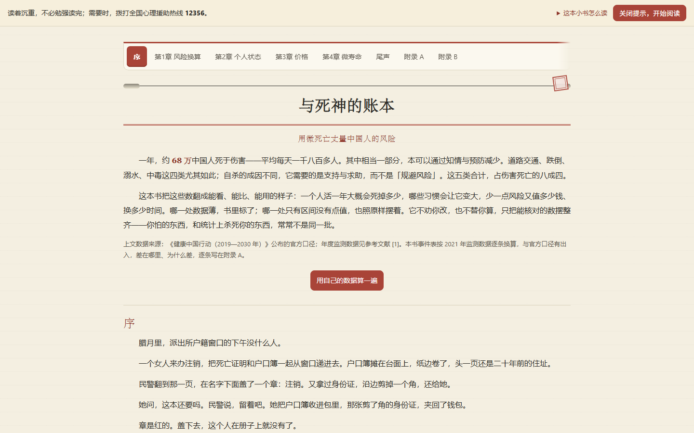

# 与死神的账本 · 用微死亡丈量中国人的风险

> 把日常风险换算成同一把尺子，看见自己站在哪儿。



<sub>首屏（1.0.5 版式，无头 Edge 1440×900 截取）。</sub>

## 打开就能读

双击 `index.html`。不用安装，不用联网，不用注册。

全书四章加两个附录，读完大约二十分钟。只想算自己那一段，从第 2 章开始；只想知道新闻里的数字意味着什么，第 1 章就够。

这本书谈的是死亡。读到不适可以停下来——页面顶部有心理援助提示（可一键关闭），热线 12356 也一直留在页脚。

## 这本书在做什么

一年有约 68 万中国人死于伤害，平均每天一千八百多人。这些数字散在生命表、流行病学研究和统计公报里，单位各不相同：每十万人、每年、每次。

这本书把它们换成同一把尺子：**微死亡**，百万分之一的死亡概率。跳一次伞约 8 微死亡，坐一趟航班 0.02 微死亡；一个不烟不酒、指标正常的四十岁男性，一年「该」冒的风险是 1922 微死亡。

换成同一把尺子，很多问题才问得下去：这件事值不值得怕？我比同龄人高多少？少一个微死亡，我愿意付多少钱？

## 四章，四个问题

| 章 | 回答的问题 |
|---|---|
| 第 1 章 风险换算 | 跳伞和航班差 400 倍，差在哪儿？ |
| 第 2 章 个人状态 | 我的身体数据，把我放在哪一格？ |
| 第 3 章 价格 | 少一个微死亡，值多少钱？ |
| 第 4 章 微寿命 | 每天到底被扣掉多少时间？ |
| 附录 A 数据与来源 | 这些数是谁数的、怎么数的？ |
| 附录 B 参考文献 | 每个数字后面跟着哪一条出处 |

每章跟着一个人过日子——山上的秦远、替全家看体检单的林安、跑长途的陈建军、厨房里撕日历的陈桂芳；附录 A 里是追查数据出处的周平。同一个数字落到他们身上，反应各不相同。

## 数字从哪来

能查到出处的数字才写进来。正文里每个数字旁边都有「来源与著录」，点开是文献、数据来源和折算过程。

- **基线**：WHO 中国一般人口生命表 2019–2023；5 岁组先连乘到组端点、组内用单调三次样条（PCHIP）插到单岁，85 岁以上用表内单岁值（由 5 岁组按 Gompertz 展开后平滑）。
- **九个健康状态**：系数锚定中国成人调查人群平均；生活方式四项按 1.12 插值，代谢四项封顶在 1.92（封顶后不再随因素增加）。
- **曲线上的蓝带**：模型参数的不确定范围，不是统计置信区间；同一份输入每次得到同一条带。带子越宽，越不该照着它做决定。
- **生命价值**：24 篇中国 VSL 研究逐篇呈现，不平均成一个数——不同方法测的不是同一个量。

六份底稿在 `data/`，可以下载、可以复算。不需要统计背景也能读；想核对的时候再展开，不想核对就跳过。

## 隐私

没有服务器，没有账号，不联网。你填的东西只存在自己这台电脑的浏览器里。共用电脑时，用页面底部的「管理本机数据」清除。

## 许可与引用

[CC BY-NC 4.0](https://creativecommons.org/licenses/by-nc/4.0/)：署名、非商业性使用；商业用途须事先取得作者许可。转发、改编并公开发表须保留作者名与作品名；个人学习、研究、体验自由。引用格式见 `CITATION.cff`。

© 2026 [Dasein0721](https://github.com/Dasein0721)

## 给要核对、二次使用或改这份代码的人

- **底稿**：`data/` 下六份，与正文数据同源——[生命表](data/life-table-WHO2019-2023.md)、[微死亡事件汇编](data/micromort-events.md)、[价格折算指数](data/price-index.md)、[VSL 文献清单](data/vsl-bibliography.md)、[校准方案](data/model-calibration.md)、[状态系数参照表](data/state-coefficient-averages.md)；索引见 [data/README.md](data/README.md)
- **自检**：`npm test`（verify 51 + funfact 6 + init 20 + render 44 = 121 条断言）
- **边界**：测试在 Node 沙箱里用 DOM 桩跑真实函数，不覆盖真实浏览器的排版、打印与 localStorage 行为；改完仍建议手动开一次页面。`npm run check` 另加 lint 体检（110 个 id / 31 个控件 / 1 个锚点）
- **版本记录**：`CHANGELOG.md`

### 代码结构

单文件 `index.html`，零依赖、不联网。脚本顶部 `APP_DATA` 集中放数据（生命表、58 条事件、60 条目录、34 条参考文献），其后是 `Model` / `Chart` / `Report` 三个 IIFE，存储只走 `Storage` 门面。

### 目录

```
index.html             主程序（单文件，零依赖）
verify.js              自动化断言（51 条）
lint.js                静态体检（语法、控件可达名、引用锚点）
_test_funfact.js       趣闻回归（6 条）
_test_init.js          初始化冒烟（20 条）
_test_render.js        渲染回归（44 条）
package.json           npm test 入口
CHANGELOG.md           版本记录
CITATION.cff           引用信息
LICENSE                许可全文（CC BY-NC 4.0）
docs/screenshot.png    首屏截图
data/                  六份数据底稿（索引见 data/README.md）
```

### 版本号

`x.y.z` 三段各管一件事：

| 位 | 什么时候动 | 例子 |
|---|---|---|
| `z` 补丁 | 口径修正、缺陷修复、文案与无障碍，**功能边界不变** | 1.0.2 → 1.0.3（生命表重建、导出按钮、模型口径、叙事改写） |
| `y` 次版本 | 新增功能模块或结构调整 | 1.1.0 |
| `x` 主版本 | 几乎不是同一件东西了 | 2.0.0 |

当前 **1.0.5**（2026-11-17；版本号锁定：上传 GitHub 前不再升版，之后的修改仍记在这一版里）：无障碍与可用性一轮，数字、模型、生命表与事件值一律不动。正文与源注的小字加深到 AA 以上（全页实测最低对比度 5.12:1，原来最小的 12px 灰字 4.27–4.43）；按钮、输入框、选项卡与复选行设最小点击高度（桌面 32–36px，移动端复选框 22px）；479px 以下章节导航隐去「第/章」二字，只留章号与标题，最后一章不再被右侧渐隐遮住末字；数字卡不再把整块 143–200 字当 live region 重播，改由一个 26 字左右的状态行播报「未来 N 年存活率 X%」；状态对比项（系数行）在事件列表里明确标注「不参与累计」；同名同口径的事件重复加入时自动合并数量，年度风险重复添加直接忽略并说明；每张数据表补朗读用 caption，真的横向溢出时才显示「← 表格可左右滑动 →」提示；报告头版本号改由单一常量 APP_VERSION 生成。verify.js 断言 43 → 51，总数 121 条。打印页眉/页码本轮未做，原因写在 CHANGELOG。

同属 1.0.5（2026-11-17）：三处口径与可信度修正——卷首报告段「五类合计八成四」改注《健康中国行动（2019—2030 年）》官方口径，并说明本书事件表逐条换算约七成（道路按 WHO 口径约八成二）；附录 A 的 e₀ 对照句由「比国家公布值低约 2–3 岁」改回「WHO 中国总人口 78.45 岁，比卫健委 2024 年 79.0 岁低约 0.6 岁」，并写明分性别值不能与全国合计直接相减；蓝带蒙特卡洛改为按输入派生固定种子，同一份档案刷新/打印不再漂移。另修：损坏的事件/输入存储不再静默丢弃（原文另存 rb_events_corrupt / rb_inputs_corrupt 并提示）；卷首数据说明下放到附录 A，第 1–4 章与尾声做了一轮叙述与编校整理。断言 113 条。
